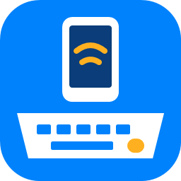
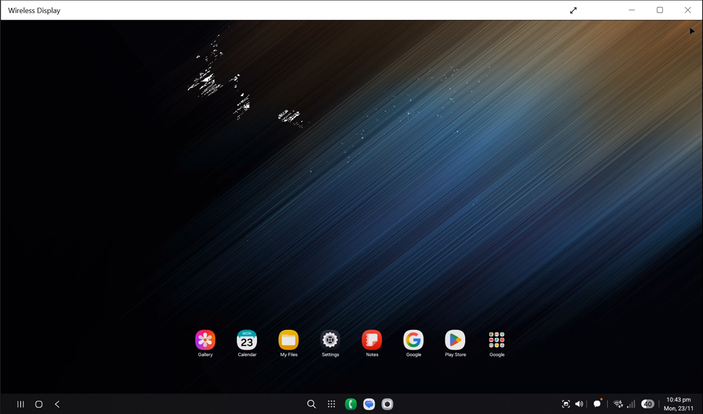
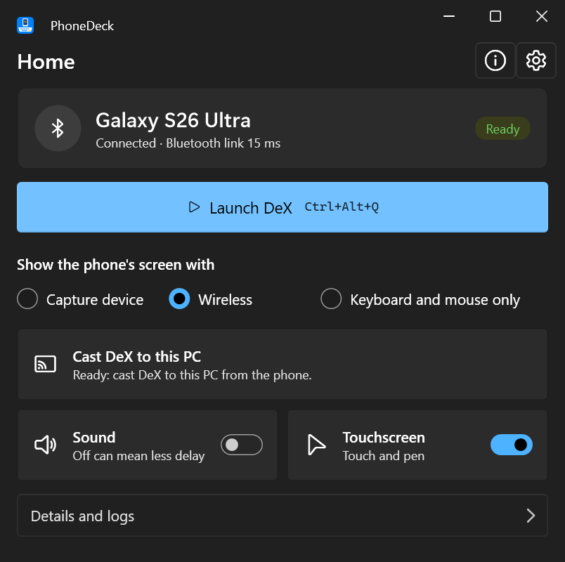

# PhoneDeck



**A DeX alternative for Windows.** PhoneDeck turns a Windows PC into the monitor, keyboard,
mouse, touchscreen and pen for an Android phone running a desktop mode such as Samsung DeX.
The PC's input reaches the phone over Bluetooth, as a real keyboard and mouse would, so
nothing needs installing on the phone and developer options stay off.

It works in either of two ways of showing the phone's screen:

- **Capture device:** the phone's USB-C video output goes into a **USB video capture device**,
  shown in PhoneDeck's own low-delay viewer. It also shows **work apps that block wireless
  casting**, since a wired display looks like any monitor to the phone.
- **Wireless:** the phone casts DeX to the PC over Wi-Fi, and PhoneDeck receives the cast itself
  and shows it in its own window at up to 60 fps. No extra hardware is needed, but there is more
  delay. Windows' **Wireless Display** app is kept as a backup.

Either way, the keyboard, mouse, touch and pen all work, with a button bar for Android's
navigation buttons.



## Credits

PhoneDeck's Bluetooth layer is **[windows-ble-hid](https://github.com/abhishek-raj/windows-ble-hid)
by Abhishek Raj** (MIT License). His code presents the PC to the phone as a Bluetooth LE
keyboard and mouse (HID over GATT), and also provides the input capture, multi-host switching,
lock-key tracking, and the CLI and background mode. PhoneDeck builds the rest around it: the
capture viewer, the cast receiver, touch and pen, the navigation bar, and the app
itself. See [What PhoneDeck adds](#what-phonedeck-adds).

His project's history is kept in this repository, so his commits stay credited to him. His
original README is in [docs/ORIGINAL-README.md](docs/ORIGINAL-README.md), and his developer
notes are in [DEVELOPMENT.md](DEVELOPMENT.md).

## Requirements

- Windows 10 version 2004 or later, on x64 or ARM64.
- A Bluetooth radio that supports the **LE peripheral role** (Details → Logs shows
  `Peripheral=True`).
- An Android phone that accepts Bluetooth keyboards, mice and touchscreens.
- To show the phone's screen: a USB video capture device and a phone with video output, or a
  phone that can cast DeX and a PC whose Wi-Fi can receive a cast (Windows' **Wireless Display**
  optional feature installed).

Tested on a Surface Pro with a Snapdragon X processor (ARM64) and a Surface Go 3 (x64), with a
Samsung Galaxy S26 Ultra and a Galaxy S22 Ultra in DeX.

## Getting started

1. Download the zip for your PC from [Releases](https://github.com/BeShO-ShO/PhoneDeck/releases)
   and run `PhoneDeck.exe`. It is unsigned, so Windows may warn you the first time
   (More info → Run anyway).
2. Pair the phone with the PC from the phone's Bluetooth settings. In the PC's Bluetooth details
   on the phone, leave only **Input device** on: Media audio and Phone calls compete for the
   radio and add mouse lag.
3. On Home, choose **Capture device** or **Wireless** to show the phone's screen. For a capture
   device, pick it in Settings → Phone's screen.
4. Each time: open PhoneDeck, tap **Connect** for the PC on the phone, then press
   **Ctrl+Alt+Q** (or **Start capture**). Press it again to return input to the PC.



While capture is on, a small bar below the picture has **Split screen, Recents, Home and Back**,
a full-screen button, and a button that turns capture off.

## Showing the phone's screen

### Capture device (built-in viewer)

Any USB capture device that Windows sees as a camera should work. Starting capture opens
PhoneDeck's viewer full screen. It picks the device's best mode, reads it with Windows' own
low-latency capture, and draws each frame on the graphics card as soon as it arrives.

- **Double-click, F11 or F** switches between full screen and a window; **Esc** leaves full
  screen. While input goes to the phone, double taps belong to the phone and the bar's
  full-screen button does it instead.
- **Sound** from the capture device is a switch on Home. Off can mean slightly less delay. On a
  Samsung phone, send DeX's sound to the capture device with **Quick settings → Audio output →
  Display device**.
- **Picture** settings (black and white levels, brightness, contrast, colour) are in Settings
  and apply instantly, with no added delay.

**mpv as a backup.** If the built-in viewer doesn't work on your PC, choose **mpv** in Settings →
Phone's screen. PhoneDeck then starts [mpv](https://mpv.io/) (0.42 or newer recommended) with
low-delay options and follows its window for touch. To start mpv yourself, see
[docs/MPV.md](docs/MPV.md).

### Wireless

Choose **Wireless** on Home. While it is chosen, PhoneDeck listens for a cast, and Home shows
whether it is ready. Cast DeX to the PC from the phone; starting capture shows it full screen.

- The first cast makes Windows ask to let PhoneDeck through the **firewall**. Allow it on private
  networks, or the phone can't reach it.
- The keyboard, mouse, touch, pen and the bar work as with a capture device, and the **sound**
  switch on Home plays or mutes the cast.
- PhoneDeck only reads Windows' "Projecting to this PC" settings and never changes them. Close
  the Wireless Display app while using it, or the phone may cast there instead.

### Wireless Display app (backup)

If PhoneDeck can't receive the cast on your PC, choose **Wireless Display app** in Settings →
Receive Wireless with. Starting capture then opens the app if it isn't open; cast DeX to the PC
from the phone.

- **Touch** works through the cast itself. PhoneDeck adds the keyboard, mouse and pen.
- **Don't minimise** Wireless Display, use **Win+D**, or switch away from its own full screen
  (Win+Shift+Enter): each of these ends the cast. Covering it with other windows is fine.
- Use the bar's buttons instead: **full screen** stretches the window over the screen above the
  taskbar, and **send to back** puts it behind your other windows.

## Tips

- For the easiest pointer, turn on **Enhance pointer precision** in the phone's mouse settings
  (Android, next to pointer speed; not the Windows setting).
- On slower PCs, Windows' **Best performance** power mode makes a clear difference to delay.
- A capture adapter with a USB-C power input keeps the phone charged; DeX and Bluetooth drain it
  quickly.

## What PhoneDeck adds

On top of windows-ble-hid v0.6.0:

- **Touch input**: up to five fingers (pinch-zoom, two-finger scroll), read straight from the
  PC's touchscreen and mapped onto the picture.
- **Pen input**: hover, pressure, the barrel button and the eraser.
- **Two ways to show the phone**: a built-in low-delay capture viewer (with mpv as a backup), or
  its own wireless cast receiver (with Windows' Wireless Display app as a backup).
- **Navigation bar** for Android: Split screen, Recents, Home and Back.
- **Ctrl+Alt+Q** toggles capture on and off, and always turns on to the phone.
- **Lower pointer delay**: the fastest Bluetooth link the phone allows (Windows 11), and pointer
  motion spread evenly across reports so Android's acceleration sees a steady speed.
- **Reliability**: held keys and buttons are released on stop, and the last phone is reselected
  when it reconnects.
- **Compact window** with Home, Details and Settings.

## Building

Requires the .NET 8 SDK.

```
dotnet test tests/PhoneDeck.Core.Tests/PhoneDeck.Core.Tests.csproj
dotnet publish src/PhoneDeck.App/PhoneDeck.App.csproj -c Release -r win-arm64 --self-contained true -p:PublishSingleFile=true -o out/arm64
dotnet publish src/PhoneDeck.App/PhoneDeck.App.csproj -c Release -r win-x64 --self-contained true -p:PublishSingleFile=true -o out/x64
```

Pushing a tag starting with `v` runs the release workflow, which builds both and attaches the
zips to a GitHub release.

## Troubleshooting

- **Input stops reaching the phone, but PhoneDeck shows it connected**: restart the phone.
- **The phone pairs only as an audio device**: forget the PC on the phone, remove the phone in
  Windows' Bluetooth settings, then pair again with PhoneDeck open.
- **Pen does nothing** after updating from an older PhoneDeck: pair again as above. Fingers work
  without re-pairing.
- **No picture in the built-in viewer**: check the device in Settings → Phone's screen, and close
  any other app using it (Details → Logs says why). If it still fails, switch to mpv.
- **The phone can't find the PC to cast to, or the cast fails**: check that Home says it is
  ready, that the Wireless Display app is closed, and that PhoneDeck is allowed through the
  firewall. If it still fails, use the Wireless Display app (Settings → Receive Wireless with).

## Known limitations

- Touch and pen work only on the main display, where the PC's touchscreen is.
- With the Wireless Display app, the Windows pointer can stay visible over the picture until the screen
  is touched.
- After PhoneDeck restarts, the phone usually needs a **Connect** tap to reconnect.
- Builds are unsigned, so Windows SmartScreen may warn on first run.

## License and trademarks

MIT — see [LICENSE](LICENSE). Copyright BeShO-ShO (PhoneDeck) and Abhishek Raj
(windows-ble-hid). The built-in viewer uses
[Vortice.Windows](https://github.com/amerkoleci/Vortice.Windows) and
[NAudio](https://github.com/naudio/NAudio), both MIT.

Samsung DeX, Android, Bluetooth, Windows and Surface are trademarks of their respective owners.
PhoneDeck is not affiliated with or endorsed by any of them, or by any capture device's maker.
