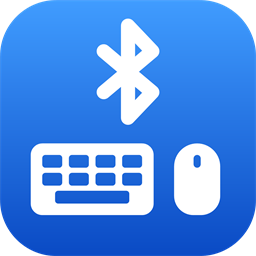

# PhoneDeck



Use a Windows PC's **keyboard, mouse and touchscreen** to control an Android phone over
Bluetooth, while the phone's screen is shown on the PC through a **USB video capture device**.

PhoneDeck is built for one fairly specific setup: an Android phone running a desktop mode
(such as Samsung DeX) whose video output goes into a capture device plugged into a Windows PC,
and is watched full screen in a video player such as mpv. The PC becomes the phone's monitor
*and* its keyboard, mouse and touchscreen. If that is not your setup, the original project it
is based on (below) may suit you better.

## Credits

PhoneDeck is a derivative of **[windows-ble-hid](https://github.com/abhishek-raj/windows-ble-hid)
by Abhishek Raj**, released under the MIT License. All of the Bluetooth work that makes this
possible — presenting a Windows PC as a Bluetooth LE keyboard and mouse (HID over GATT), the
input capture, multi-host switching, lock-key tracking, the CLI and background mode, and the
research behind them — is his. The full history of the original project is kept in this
repository, so his commits remain credited to him. His experimental Android companion app is
not part of PhoneDeck; it is available in the
[original repository](https://github.com/abhishek-raj/windows-ble-hid).

His original README, with the detailed technical background, is kept as
[docs/ORIGINAL-README.md](docs/ORIGINAL-README.md), and his developer notes are in
[DEVELOPMENT.md](DEVELOPMENT.md). Paths in both were updated for the rename.

PhoneDeck adds the capture-device workflow on top. See [What PhoneDeck adds](#what-phonedeck-adds).

## How the setup fits together

```
 Android phone ── USB-C video out ──► capture device ── USB ──► Windows PC
      ▲                                                        │
      │                                              mpv shows the phone's screen
      │                                                        │
      └──────────── Bluetooth LE: keyboard, mouse, touch ◄── PhoneDeck
```

- The **capture device** turns the phone's video output into something Windows sees as a
  webcam. mpv shows it full screen.
- **PhoneDeck** presents the PC to the phone as a Bluetooth keyboard, mouse and touchscreen.
  While capture is on, the PC's keyboard and mouse go to the phone, and touches on the video
  land on the same spot on the phone's screen.

### Capture device

Any USB capture device that Windows recognises as a camera should work. For reference only —
**this is an example, not a recommendation** — the setup PhoneDeck was developed on uses a
Benfei USB-C to USB-C capture adapter. It delivers uncompressed 1080p at 60 frames per second
over USB 3, and has a USB-C power input that passes charge through to the phone, which helps
because desktop mode plus Bluetooth drains the battery quickly. The device names in the mpv
commands below (`USB3 Video`, `Digital Audio Interface (USB3 Digital Audio)`) are what that
adapter reports; yours will differ.

To find your device's names, run:

```
mpv av://dshow:list_devices=true
```

### Video player: mpv

[mpv](https://mpv.io/) is used to show the capture device. On the development setup, **mpv 0.42
or newer** was markedly faster than 0.40, to the point of removing a noticeable picture delay.

Without sound (lowest delay):

```
mpv av://dshow:video="USB3 Video" --cache=no --osc=no
```

With sound from the capture device (adds a little delay):

```
mpv av://dshow:video="USB3 Video":audio="Digital Audio Interface (USB3 Digital Audio)" --cache=no --osc=no --demuxer-lavf-o=audio_buffer_size=50
```

- `--cache=no` stops mpv building up a buffer.
- `--osc=no` hides mpv's on-screen controls, which touches would otherwise bring up.
- `--demuxer-lavf-o=audio_buffer_size=50` shrinks the capture audio buffer from its default of
  about half a second, which otherwise delays the picture too.
- Press `f` for full screen. PhoneDeck's touch mapping assumes a **full-screen 16:9 picture on
  the main display**, letterboxed if the screen is a different shape.

Options that made things **slower** on the development setup, so are best avoided there:
`--profile=low-latency`, `--untimed`, and `--profile=fast`. Results may differ with other
hardware.

On a Samsung phone in DeX, sound goes to the capture device when you choose
**Quick settings → Audio output → Display device** inside DeX. On slower PCs, Windows'
**Best performance** power mode makes a clear difference to video delay.

When making a Windows shortcut for these commands, make sure nothing follows the last option
when pasting: a hidden line break at the end stops mpv starting from a shortcut, even though the
same command works in a terminal.

## Requirements

- Windows 10 version 2004 or later, on x64 or ARM64.
- A Bluetooth radio that supports the **LE peripheral role**. Check in PhoneDeck under
  Details → Logs for `Peripheral=True`.
- An Android phone that accepts Bluetooth keyboards, mice and touchscreens.
- For the touch and viewing workflow: a USB video capture device and a phone with video output.

Developed and tested on a Surface Pro with a Snapdragon X processor (ARM64) and a Surface Go 3
(x64), with a Samsung Galaxy phone on Android 16 in DeX. Other combinations are untested.

## Using PhoneDeck

1. Run `PhoneDeck.exe`. It is unsigned, so Windows may warn you the first time
   (More info → Run anyway).
2. On the phone, pair with the PC from Bluetooth settings. In the PC's Bluetooth details on the
   phone, leave only **Input device** on; Media audio and Phone calls compete for the radio and
   add mouse lag.
3. Each time: open PhoneDeck, tap **Connect** for the PC on the phone, then press
   **Ctrl+Alt+Q** (or **Start capture**). Press it again to return input to the PC.

The window has three views:

- **Home** — the phone's connection and link speed, Start capture, where input goes, and the
  **Use the touchscreen** switch.
- **Details** (ⓘ) — the Bluetooth service, pointer pacing, shortcuts and logs.
- **Settings** (⚙) — startup, closing behaviour, and optional switch keys.

While capture is on with touch enabled, a small bar sits in the black area below the video with
**Split screen, Recents, Home and Back** buttons and a pause button that turns capture off.

## What PhoneDeck adds

Compared with windows-ble-hid v0.6.0:

- **Touch input**: a single-finger touchscreen report, read directly from the PC's touchscreen
  (Raw Input) with nothing drawn over the video, mapped onto the letterboxed video.
- **Navigation bar** for Android: Split screen, Recents, Home and Back, sent as keyboard
  shortcuts because edge gestures can't be performed by an external touchscreen.
- **Ctrl+Alt+Q toggles** capture on and off, and always turns on to the phone.
  Ctrl+Alt+CapsLock and Ctrl+D+C target switching are optional and off by default.
- **Compact window** with Home, Details and Settings, and touch scrolling.
- **Remembers the last phone** and reselects it when it reconnects.
- **Sends input only to paired devices**, and shows whether the link is really live.
- **Reliability**: held keys and buttons are released on stop, Bluetooth requests that arrive
  after a disconnect no longer crash the app, and a lost touch contact no longer freezes touch.
- **Lower lag on the PC**: the mouse hook is removed while input stays on the PC.
- **Smaller download**: compressed single-file builds.

## Building

Requires the .NET 8 SDK.

```
dotnet test tests/PhoneDeck.Core.Tests/PhoneDeck.Core.Tests.csproj
dotnet publish src/PhoneDeck.App/PhoneDeck.App.csproj -c Release -r win-arm64 --self-contained true -p:PublishSingleFile=true -o out/arm64
dotnet publish src/PhoneDeck.App/PhoneDeck.App.csproj -c Release -r win-x64 --self-contained true -p:PublishSingleFile=true -o out/x64
```

Pushing a tag starting with `v` runs the release workflow, which builds both and attaches the
zips to a GitHub release.

## Troubleshooting

- **Input stops reaching the phone, but PhoneDeck still shows it connected**: restart the phone.
  After a fresh pairing, Android sometimes needs this before input works.
- **The phone pairs only as an audio device**: forget the PC on the phone, remove the phone in
  Windows' Bluetooth settings, then pair again with PhoneDeck open. Check that **Input device**
  appears.
- **After updating from BleHid**: settings move to `%LOCALAPPDATA%\PhoneDeck` automatically on
  first launch. Re-pairing is not needed.

## Known limitations

- One finger only; multi-finger touch gestures are not sent.
- Touch mapping assumes a 16:9 video, full screen on the main display.
- Builds are unsigned, so Windows SmartScreen may warn on first run.
- After PhoneDeck restarts, the phone usually needs a **Connect** tap in its Bluetooth
  settings to reconnect.

## License and trademarks

MIT — see [LICENSE](LICENSE). Copyright Abhishek Raj (original work) and BeShO-ShO
(PhoneDeck modifications).

Samsung DeX, Android, Bluetooth, Windows and Surface are trademarks of their respective owners.
PhoneDeck is not affiliated with or endorsed by any of them, or by the capture device's maker.
